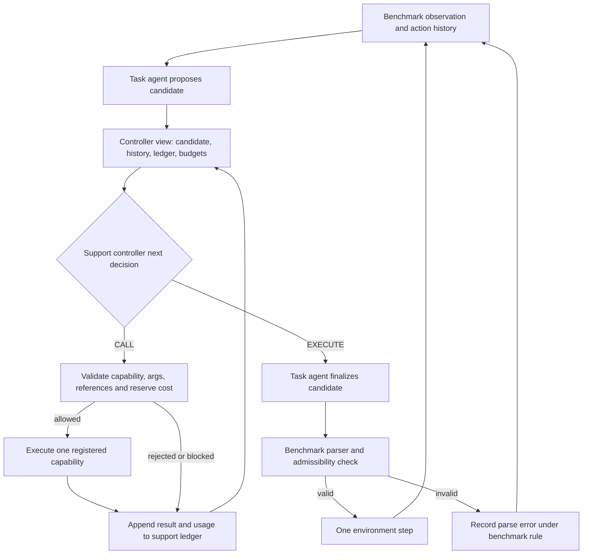

# Autonomous adaptive support planning for LLM agents

**Design proposal, 18 November 2026.** Analysis only; no runner, model, experiment, or historical result was changed. This proposal distinguishes the checked-out `main` branch at `aba4da7` from later versioned branches. Paths named below are relative to the repository unless a branch is specified.

## 1. Research objective and boundary

At each environment decision, a task agent proposes an action. A separate support controller may inspect the task state, call one validated support capability, inspect its result, and choose again. It eventually emits **EXECUTE** or reaches a bound. Support operations may produce notes, plans, evidence, or candidate revisions, but only the task agent's finalized, benchmark-validated action reaches `episode.step`. The controller chooses the *procedure* one operation at a time; it is not offered a menu of M2/P3/V2/V3 strategies or a prewritten pipeline.

The first implementation should operate within one environment decision. State persists across decisions within an episode, so a controller can recognize repeated failures and use earlier support artifacts. A later learned controller should implement the same decision contract. No generated text may be interpreted as shell commands, Python, imports, file paths to open, or arbitrary tool names. Only capabilities registered and enabled for the run may execute.

## 2. Repository audit and reusable infrastructure

| Concern | Audited implementation | Reuse and required change |
| --- | --- | --- |
| Benchmark runners | `main:agent_support/runner.py` runs TextCraft and ALFWorld through `make_episode`; TextCraft replays the manifest's exact displayed recipes and goal, while ALFWorld checks game hash and reset identity. The later `delegation_token_reservation_fix` branch adds benchmark drivers for prompt, parse, and stop rules. | Reuse adapters, manifests, and drivers. Add a new runner path for the controller; do not alter frozen condition paths. TextCraft `inventory` is an **environment action** and must consume an action budget if used. |
| Task prompts and parsing | `main:agent_support/policy.py` uses the last eight interactions by config. ALFWorld expects a single one-based admissible-action number; TextCraft accepts a constrained `get`, `craft`, or `inventory` command. ALFWorld parse errors end the episode; TextCraft parse errors enter history without an environment step. The later branch retains these drivers and records parse stage. | Keep prompt and parser versions fixed for matched baselines. Parse every candidate action at the final task-agent boundary against the current admissible list or TextCraft grammar; syntactic validity is not proof of recipe validity or goal progress. Controller output needs its own strict structured parser. |
| Support selection | `main:agent_support/support_policy.py` exposes `TurnContext` and `SupportPolicy.select`, called once before and once after the proposal. It validates phase and support IDs; an ordered tuple can contain several supports, but the whole tuple is selected before any of their results are observed, and a support cannot repeat within a phase. The later branch adds `SelectionDecision`, budgets, random/failure/always/never policies, and per-episode policy state. | Reuse fixed policies as baselines. A feedback-driven `next(context, ledger)` contract and loop are new; extending `select` alone would hide the central research difference. |
| Support executors | On `main`, retrieval and revision logic are embedded in the runner. The `delegation_token_reservation_fix` branch has `supports.py` with a registry, `SupportAdapter.invoke`, `SupportResult`, requirements, versions, and provenance. Its adapters still correspond to combined strategies such as retrieval **plus** reconsideration or model replacement. | Reuse retrieval engines and selected adapter internals. Add smaller, typed capabilities and a result envelope so retrieval, reasoning, candidate revision, and validation can be composed in a controller-chosen order. Keep legacy support IDs for replaying old conditions. |
| M2 memory | `main:agent_support/memory.py` builds training-only action transitions, filters retrieval to accepted actions in successful episodes with matching action target/object, and ranks MiniLM embeddings. `trajectory_memory.py` stores successful episodes, renders accepted steps, and uses pinned MPNet task/step vectors; action-conditioned ranking combines 0.4 task and 0.6 best-step similarity, with top-k and example-token limits. `runner.py` checks evaluation exclusion and corpus/index hashes. | Reuse `ActionMemory` and `TrajectoryMemory` as read-only data sources. Expose retrieval as an artifact-producing primitive, not an automatic action revision. Preserve exclusion, fingerprint, revision, and token-budget checks. Retrieval quality and task progress remain separate measurements. |
| Qwen and GPT-OSS | `main:agent_support/model.py` supplies Qwen2.5-7B-Instruct in NF4 with greedy generation. The later branch registers model adapters, adds GPT-OSS-20B with packed MXFP4 verification and Harmony final-channel extraction, and uses persistent Qwen/GPT-OSS worker processes for hybrid delegation. The hybrid chooses a replacement model before the proposal and may fall back to Qwen after invalid output. | Reuse model adapters and worker routing where available. Add distinct task/controller/support model roles and count every generation, including malformed output and fallback. Model delegation may become a capability, but its current pre-proposal replacement semantics are a baseline, not a general controller loop. |
| State and histories | The main runner stores action/observation history, a trace per decision, and support events. In the later branch, `TurnContext` also has recent `failed_action` flags and remaining budgets. Only executed actions and feedback enter later task prompts in the delegation runs. ALFWorld marks failure only on exact `Nothing happens.`; accepted off-goal actions are not failures. | Create an episode-scoped support ledger with immutable artifact IDs and links to decisions. Show the controller the current observation, recent history, proposal, support results, and budget state. Do not call a local action “progress” without an explicit task-specific measure. |
| Logging and recovery | Main runs write unique `config.json`, `manifest.json`, `run.json`, `summary.json`, and per-task `episodes/*.json` atomically. The later schema-v2 branch adds `checkpoint.json`, content digests, resume verification, runtime attempts, worker logs, and support-token reservations. Recovery is at **completed episode** granularity. | Reuse schema-v2 run storage for new conditions if that branch is the implementation base. Record each controller decision and capability result inside the episode trace. A preempted mid-episode controller loop needs either restart-from-task with a new attempt ID or a separately validated state snapshot; existing checkpoints do not resume the loop mid-episode. |
| Evaluation and tests | `main:agent_support/analysis.py` checks manifest equality and has condition-specific comparisons; `heldout_evaluation.py` and the later branch's reports provide paired outcomes and cost accounting. Main tests cover adapters, replay, memory leakage, prompt/parser behavior, ordered supports, and comparisons. Later tests cover worker routing, budgets, packed-model handling, extensibility, and checkpoint recovery. | Reuse fake-model/fake-environment test patterns and manifest gates. Add controller-loop tests. Existing comparison functions do not accept an arbitrary controller condition; build a new paired analyzer or explicitly extend a versioned one. Keep development and held-out protocols separate. |

### Historical evidence that shapes the design

The locally verified progress report under `reports/complete_research_summary/` reconciles 22 versioned runs and their episode hashes. On 20 development tasks at seed 42, standalone Qwen/GPT-OSS and five-call random/failure delegation solved **4/14/9/8 TextCraft** and **2/6/4/2 ALFWorld**. ALFWorld failure-triggered delegation made zero GPT-OSS calls because its narrow failure flag never fired. These results motivate richer state assessment, but do not identify an optimal gate.

The matched GPT-OSS TextCraft standalone/reconsideration/M2-11 comparison solved **14/14/14 of 20**, with **303/562/598 model calls**. M2-11 made 297 retrievals and 167 action replacements without aggregate gain. The trace audit documents repeated invalid recipes and examples that were semantically close but did not resolve the current bottleneck. Therefore the controller must log *why* an artifact was requested, whether it changed the candidate, and what happened after execution; replacement count and accepted actions are not success metrics. The M2-50 15/20 claim and M2-200 collection status are explicitly unverified locally in `reports/complete_research_summary/missing_data.md`. The separate `reports/memory_scaling_v1/` package on the `m2_memory_scaling_v1` lineage describes nested corpora and CPU validation, but its local status has no M2-50/200 evaluation artifacts. Do not treat those as established performance points.

The `adapt_dynamic_replanning` branch contains a distinct TextCraft ADaPT controller with recursive decomposition, planner/executor roles, and global call/depth limits. It demonstrates that an episode controller can reuse the TextCraft adapter. Its logic is a particular execution-first decomposition algorithm, has its own parser and 120-action development budget, and is not a general capability-selection controller or a matched continuation of the 30-action M2 studies.

## 3. Proposed architecture

### Roles and state

1. **Task agent.** Uses the benchmark driver to propose an action from the current observation and history. After support, it finalizes an action using a bounded bundle of support artifacts. The task agent owns the candidate; the benchmark driver validates it. A simple first version may let a validated revised candidate replace the original, while preserving both in the trace.
2. **Support controller.** Receives a `ControllerView`: task/observation, available actions, recent actions and feedback, current candidate, prior support outcomes, permitted capability schemas, and exact remaining budgets. It returns one structured decision: `CALL(capability_id, arguments, input_artifact_ids, reason)` or `EXECUTE(reason)`. It may choose no support, repeat a capability if allowed, or build a new sequence after seeing each result. A controller algorithm is replaceable without changing capability implementations.
3. **Capability registry and executor.** Each registered, versioned capability declares argument schema, input/output artifact types, model or data requirements, side-effect class, maximum reservation, and provenance. The executor validates identity, arguments, references, state preconditions, permissions, and budgets before invocation. The initial registry is read-only with respect to the environment; only the task-agent execution boundary calls `episode.step`.
4. **Support ledger.** Append-only, episode-scoped records for controller decisions, validation/rejection, capability inputs/outputs, model generations, candidate lineage, and observed environment outcomes. Artifacts are immutable and referenced by ID; the controller receives bounded summaries to avoid uncontrolled prompt growth. The ledger is separate from the task agent's action history.
5. **Budget manager.** One source of truth for per-decision and per-episode support calls, controller/model calls, input/output tokens, maximum sequence depth, and a total inference-cost proxy. It reserves the worst permitted output tokens plus counted input tokens before generation, then settles against actual counts. It accounts for the controller's own calls, failed generations, retries, and fallback. A hard monetary ceiling requires a pinned price schedule per model; when prices are unavailable, enforce token/model-call ceilings and report measured inference seconds as a separate, retrospective metric.

An initial cost schedule can define `cost_units = Σ(model_input_tokens × input_weight + model_output_tokens × output_weight) + Σ(capability_fixed_units)`, with weights pinned per model in the run config. Reasoning tokens already included in output tokens must not be counted twice. Enforce `max_support_calls_per_decision`, `max_support_calls_per_episode`, `max_controller_calls_per_decision`, `max_model_calls_per_episode`, `max_support_tokens_per_episode`, `max_sequence_depth`, and `max_cost_units_per_episode`; action and decision limits remain the benchmark runner's own limits. All limits are config values, never controller-generated.

### Capability versus strategy

A **capability** does one bounded operation and returns data. An initial safe set is:

| Capability | Typed input → result | Side effects and limits |
| --- | --- | --- |
| `retrieve_experiences` | bounded query derived from task/observation/proposal, corpus selector, top-k → ranked training-only experience artifact with IDs, scores, provenance | Read-only index lookup; query length, top-k, rendered-token cap, and corpus whitelist. Can call again with a revised query within budget. |
| `reason_over_artifacts` | short natural-language objective, references to current state/history/retrievals/earlier notes, requested output type (`note`, `plan`, `assessment`, or `candidate_action`) → model-produced artifact | Model inference only. Fixed wrapper instruction, bounded objective and references, strict response schema, no tool execution. The objective is data for reasoning, never a command to the host. This generic primitive enables sequences beyond named strategy labels. |
| `inspect_candidate` | candidate action and current benchmark state → syntax/admissibility result, repeated-action and explicit-failure indicators | Deterministic local check; no environment transition. For TextCraft, parser success does not certify inventory or recipe preconditions. |

For example, a controller may choose `reason_over_artifacts` to analyze two prior failures, call `retrieve_experiences` with the discovered subgoal, ask `reason_over_artifacts` for a revised plan or candidate, call `inspect_candidate`, then `EXECUTE`. Each next choice occurs **after** the previous result. That sequence is illustrative, not encoded as a rule. Stronger-model action advice, deterministic recipe checks, or state extractors can be added as separately versioned capabilities after their semantics and costs are specified. An environment query such as TextCraft `inventory` must remain a task-agent action, with normal action budget and feedback, unless a new benchmark contract explicitly exposes a read-only state API.

The capability registry is code/configuration owned, not generated by the controller. Reject unknown names, extra fields, oversized strings, malformed JSON, invalid artifact references, and any requested operation that is unavailable in the current benchmark. Do not use `eval`, `exec`, a shell, dynamic imports from model text, or controller-supplied Python snippets. Retrieval text and environment observations are untrusted evidence: render them as quoted data, limit size, and keep controller instructions and authorization outside them.

### Interfaces (conceptual, not implementation code)

```text
TaskAgent.propose(task_state, action_history) -> ActionProposal(raw, parsed, model_usage)
Controller.next(ControllerView, SupportLedger) -> CALL | EXECUTE
Capability.invoke(validated_args, typed_artifacts, RuntimeContext) -> CapabilityResult
TaskAgent.finalize(proposal, support_artifacts, task_state) -> ActionCandidate
BenchmarkDriver.validate(candidate, current_available_actions) -> ValidAction | ParseError
BudgetManager.reserve/settle(role, capability, model, token_counts, limits) -> Permit | Block
```

For example, a controller response may be `{ "kind": "call", "capability_id": "retrieve_experiences", "arguments": { "query": "oak planks for beehive", "top_k": 2 }, "input_artifact_ids": ["proposal:7"], "reason": "The previous generic recipe failed" }`. After observing the retrieval result, it may issue another `call` or `{ "kind": "execute", "candidate_artifact_id": "candidate:9", "reason": "The candidate matches a displayed recipe" }`. These objects are parsed against a closed schema before any capability runs.

`CapabilityResult` should carry `status` (`ok`, `empty`, `invalid`, `error`, `budget_blocked`), output artifact IDs, provenance, token and time usage, and a concise observation for the controller. Capability errors are data the controller can react to when budget remains; they do not silently trigger a predefined next support. The controller's `EXECUTE` includes a reason and optional chosen candidate artifact ID. The task agent finalizes and the driver revalidates it against the **current** observation. A malformed final action follows the benchmark's documented parse-error behavior, or a separate bounded repair policy if explicitly configured and evaluated.

## 4. Data flow and stop semantics



```text
for each environment decision while action/decision budgets permit:
    proposal = task_agent.propose(current_state, action_history)
    ledger = new_decision_ledger(proposal, episode_support_state)
    while true:
        if support limits exhausted:
            log FORCED_STOP(limit); break
        choice = controller.next(view(current_state, proposal, ledger, budgets))
        log choice, raw output, parse status, reason, and budget snapshot
        if choice == EXECUTE: break
        validate CALL against registry, schemas, artifact refs, and budget
        result = execute exactly one permitted capability, or return rejection
        append result and actual usage; give result to controller on next iteration
    candidate = task_agent.finalize(proposal, selected_artifacts, current_state)
    validate candidate with benchmark driver; apply documented parse-error rule
    if valid: step environment once; record outcome and update action history
    link action outcome to proposal, support sequence, and candidate lineage
```

Depth means the number of controller `CALL` decisions in one environment decision; it is distinct from an episode support-call cap. A rejected request consumes a controller decision and depth slot to prevent invalid-output loops, but not a capability invocation. If no valid candidate exists when limits are exhausted, record a parse failure or terminate with an explicit budget status; never execute an unvalidated action. `EXECUTE` is a controller decision, even when no support was requested. No support capability mutates the environment before it.

## 5. Observability and evaluation contract

Use a new trace schema/version while retaining old result readers. Per decision, save: proposal/raw output and parser result; every controller call including no-support `EXECUTE`; capability name/version, validated arguments and artifact references; result status, compact output and artifact digest; model identity/revision and exact input/output/reasoning tokens; reservations, actual cost, wall/inference/retrieval time; budget blocks; candidate lineage; final action; environment feedback; task success; and error stage. Run metadata should snapshot controller prompt/model/version, capability catalog and schemas, model backends, corpus/index digests, manifest and task hashes, benchmark package versions, seeds, budget/price schedule, Git commit and dirty state. Avoid logging secrets from environment variables or worker paths in public artifacts.

Report paired task success and helped/hurt sets, action and decision counts, support sequences, support calls per action, controller overhead, all model calls/tokens by role, retrieval cost, budget blocks, parser failures, repeated failed actions, and downstream outcomes. Sequence frequency alone is insufficient: compare against no-support, fixed single-capability, fixed-sequence, random/failure selection, and matched extra-call reconsideration baselines at declared budgets. Record both the controller's proposed reason and the observable result; do not infer that an accepted action advanced the goal. Keep development exploration separate from a frozen held-out test. Existing 20-task results across commits and runtimes are historical references; a new matched comparison needs one source commit, manifest, task agent, parser, model settings, action budget, and environment versions, with only the controller condition changed. Budget-normalized comparisons should report realized cost and success, not assume equal realized calls from equal caps.

## 6. Incremental implementation plan

1. **Contract and CPU harness.** Choose the versioned implementation base (prefer the modular schema-v2 branch), add a new condition/config and types for `ControllerView`, decision, capability result, artifact ledger, and budgets. Keep historical configs and runner path frozen. Use fake task/controller models and fake episodes to test no support, two adaptive calls, result-dependent branching, `EXECUTE`, malformed decisions, budget exhaustion, and no environment step before `EXECUTE`.
2. **Minimal end-to-end loop.** Wire the task agent and a structured-output controller into TextCraft through a new runner path. Expose `retrieve_experiences`, `reason_over_artifacts`, and `inspect_candidate`; use an existing training-only corpus when available. Verify a synthetic CPU episode where the controller chooses a second capability based on the first result, then stops and the task agent executes one validated action. Record the full ledger. This demonstrates mechanism without GPU inference or a performance claim.
3. **Runner and backend compatibility.** Add ALFWorld driver support, model-role routing, exact token reservations, separate controller/task/support accounting, and schema-v2 episode checkpoints. If using hybrid Qwen/GPT-OSS workers, preserve their pinned backend requirements and distinguish delegation from controller reasoning. Test worker errors, Harmony extraction failure, parse fallback, and budget settlement with fakes.
4. **Baselines and analysis.** Implement versioned never/always/fixed-sequence and random/failure selection controllers using the same loop and capability catalog. Add a paired analyzer that checks full manifest/provenance and reports success, cost, and trace-level support consequences. Run CPU contract tests and inspect example traces; no training is required.
5. **Frozen pilot protocol.** After code review, pin models, controller prompt, capability catalog, budgets, corpus and index, seeds, and development task set. Do one-task GPU smoke per benchmark, then matched development runs. Audit support sequences and failures before deciding on a held-out protocol. Train a controller or add learned policies only as a later, separate research phase.

## 7. Tradeoffs and failure modes

- **Open-ended construction versus control.** A generic reasoning primitive permits novel sequences but makes attribution harder. Strict typed inputs, artifact references, a small enabled capability set, and trace-level sequence labels preserve auditability without imposing fixed M2/P3/V2/V3 strategy choices.
- **Extra inference may cost more than it helps.** Controller and support calls must be charged, including invalid outputs. Compare at both fixed caps and realized cost. Reserve output tokens before a call; measured inference seconds are not a pre-call hard bound unless a backend can enforce a timeout safely.
- **False certainty from observations.** `inspect_candidate` can check syntax, admissibility, and repetition, but cannot guarantee TextCraft inventory, recipe success, or ALFWorld goal progress. A model-generated “verified” note is only an assessment unless a deterministic state check exists. Log evidence source and uncertainty.
- **Poor retrieval or contamination.** Similar trajectories may be irrelevant; source tasks may leak into evaluation if exclusions are bypassed. Preserve the existing corpus and index integrity checks, partition audits, and rendered-token budget. Keep retrieved text as untrusted data.
- **Loops and premature stops.** Repeated retrieval or reflection can burn budget; premature `EXECUTE` may skip useful help. Limit depth, total calls and tokens, reject repeated identical requests if configured, and log both voluntary and forced stops. Any loop detector is a safety bound, not the policy being studied.
- **Candidate drift and parser failures.** Several support notes can conflict or replace a good proposal. Preserve candidate lineage and original proposal, reparse only the final candidate, and log whether a failed revision was ignored. GPT-OSS may emit an incomplete final channel; that is a generation failure before benchmark action parsing.
- **State and recovery mismatch.** Support artifacts are episode-local, while existing checkpoints resume only completed episodes. Preemption mid-episode cannot safely resume without environment-state serialization and model RNG restoration. Restart that episode under an explicit attempt ID for the first version.
- **Benchmark mismatch.** TextCraft has explicit rejected-command feedback and recipe text; ALFWorld has an admissible-action list but weak `failed_action` semantics. Give the controller benchmark-neutral fields plus declared benchmark-specific evidence, and do not use the same failure threshold as a universal need detector.
- **Causal interpretation.** A changed action or an accepted environment step is not a demonstrated support benefit. Matched reconsideration and fixed-sequence controls help separate the value of adaptive choice from extra inference and prompt content; full causal attribution still requires controlled task-level experiments.

## Minimal demonstration

Build one new TextCraft controller condition: the task agent makes a proposal; a **model-driven, non-scripted controller** emits schema-validated `CALL`/`EXECUTE` decisions over three registered capabilities; the executor returns each result to the controller; and a trace shows the controller selecting **at least two distinct support operations with the second choice conditioned on the first result**, then explicitly stopping. The task agent finalizes one action, the existing parser validates it, and only then does the environment advance. A fake model and episode first prove the loop and safety contract on CPU, but do **not** establish autonomy. The minimal autonomy demonstration needs one real controller inference trace showing the result-dependent sequence, plus a comparison against a fixed-sequence trace to verify that the procedure was not hardcoded. This is a small smoke demonstration, not a GPU benchmark or performance claim.
