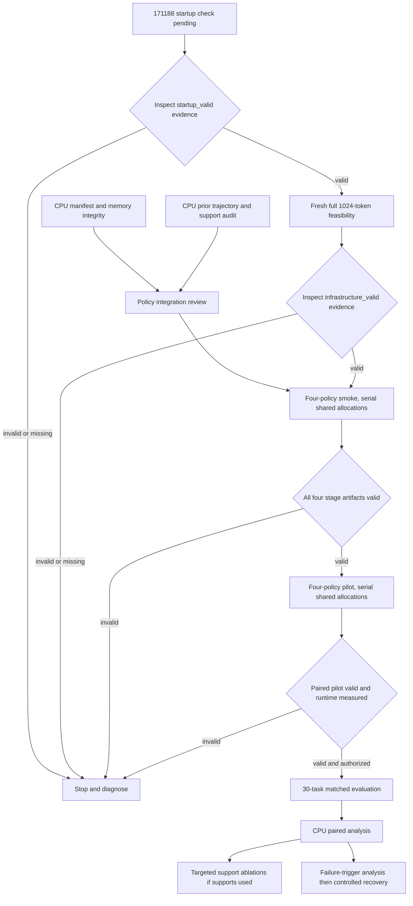

# Adaptive support selection: queued research campaign

Prepared 26 November 2026. No Slurm job was submitted or cancelled for this
campaign. Job 171188 is **user-reported pending**; its current Slurm state and
output root are not accessible from this checkout.

## Evidence and locked boundaries

- The frozen TextCraft recovery manifest has 30 unique development tasks:
  seeds `51, 126, 137, 156, 134, 72, 135, 129, 138, 151, 89, 121, 130,
  74, 58, 104, 124, 139, 93, 110, 200–209`. Its canonical digest is
  `150c7bbd973936e0f3ef8fe1266060e88de0181f0068ce98bc7bce0989a2d562`.
  The existing v4 config digest is
  `a8e57f46a11646aaaac5b50b3cc386c6770e77ff1ad557f7115de03ff4885d1e`.
  M2-200 corpus/index digests are `96a06b5e…`/`0571341c…`; the local integrity
  check found no exact task ID or observation overlap. All four policies must
  use the same frozen tasks, seed 42 model sampling, recipe order, model
  revisions, decoding, support budget, and 150-action/220-decision limits.
- The four policy definitions and evaluator exist at Git commit `701c25d`
  (`accuracy-first-terminal-review`). They are separate from the older
  `expanded_v3_v1` versus `autonomous_recovery_v4` evaluation. The former
  branch's stage/batch scripts request **one GPU and FlexAttention**. They
  cannot be submitted for this campaign. The current checkout has the exact
  three-L40S chunked-eager runtime, but lacks those four policy modules and
  opt-in runner hooks. A reviewed integration, with frozen policy digests and
  unchanged original-v4 behavior, is an explicit gate before policy GPU work.
- The user reports that overnight diagnostics passed, including an 8,887-token
  prefill. The archived job 169675 independently shows all 24 prefill layers
  executed but ended during decoding at its wall limit. Job 170811 failed
  before model loading; its root collision is a plausible, unconfirmed cause.
  The repaired five-minute startup check is job 171188. Neither a passed
  prefill nor a Slurm `COMPLETED` state establishes a completed 1,024-token
  feasibility request.
- Historical TextCraft delegation results show random/failure-triggered
  support can improve small development sets, but selection and model strength
  are confounded. Seed 89's archived v4 trajectory repeated failures and had
  backend fallbacks; it is **infrastructure-invalid**, not a v4 policy failure
  estimate. Seed 151 demonstrates that a prerequisite support can return
  incomplete evidence before inventory is observed.

## Priority and experiments

| Priority / experiment | Hypothesis and purpose | Tasks, policies, supports | Resources / time | Outcomes and run condition |
| --- | --- | --- | --- | --- |
| 0. Offline integrity and policy audit | Verify that all contrasts refer to the same tasks, frozen configuration, memory, and actual support-selection code. Identify support timing and controller stop behavior before GPU use. Existing `recovery_v4_eval.preflight`, `support_sequence_analysis`, policy commit `701c25d`, and new `campaign_offline` provide the checks. | All 30 manifest entries; archived episodes where available. No generation. Inspect all four policy definitions; no support configuration is changed. | 0 GPU, 2 CPU, 16 GiB; 15–30 min per CPU job. | Digests, overlap, support operations/results, no-support decisions, repeated failed state/actions, interventions, stops, invalidity. Run now. Missing prior run bundles remain missing, not zero-success tasks. |
| 1. Startup gate, then full feasibility | The repaired launcher reaches the intended three-GPU process split; the exact 8,887-token request can finish at the frozen 1,024-token ceiling. Existing startup/feasibility code and overnight diagnostics support attempting this, not claiming success. | No TextCraft task or policy episode. One 32-token warmup and one long request in the full gate. | **Exactly 3 L40S**, 8 CPU, 96 GiB. Startup: 5 min (job 171188); full gate: 6 h wall maximum, measured duration unknown. | `startup_valid`, then `infrastructure_valid`, nonzero long output, all 24 layers, 12/12 packed experts, Qwen isolation, memory floor and no OOM. Full gate only after inspecting 171188's result; use a fresh root. Do not queue another startup job. |
| 2. Four-policy matched comparison | State-aware checks may reduce bad repeats; candidate search may improve success beyond state awareness; terminal review may recover premature `no_viable_strategy` stops. Test incremental success versus added computation. Existing four-policy registry/evaluator at `701c25d` has telemetry, stage checks and paired reports, but requires three-GPU integration. | Same 30 task IDs and seed 42 for `original_v4`, `state_aware_v1`, `accuracy_first_v1`, `accuracy_first_terminal_v1`. Smoke index 0; pilot indices 0–2; full 30 only after both pass. All seven frozen supports remain available; policy requests differ by definition. | **Exactly 3 L40S**, 8 CPU, 96 GiB per allocation. One shared Qwen load on GPU 0 and one shared GPT-OSS 12/12 load on GPUs 1/2 per allocation. Each task has a 40-min wall ceiling. Four-policy smoke upper bound 2 h 40 min plus loading; pilot upper bound 8 h plus loading, so split across serial allocations within partition wall limit. Full upper bound 80 task-hours plus loads; batch size set only from pilot timing. | Primary: environment-verified success by task. Secondary: actions, failed actions, support calls by operation and time, intervention and terminal-review counts, replanning/strategy changes, Qwen/controller/support calls, input/output tokens, inference and elapsed seconds. Run after feasibility, integration, strict Locust preflight, then valid smoke/pilot. A `COMPLETED` Slurm state alone is insufficient. |
| 3. Targeted support ablation | Determine whether memory retrieval, prerequisite verification, or candidate generation contributes beyond the rest of the adaptive policy. This is a new, explicitly versioned intervention; existing support executors make it feasible but no ablation evaluator is implemented. | Predeclare six development seeds `51, 126, 137, 156, 151, 89` (first four manifest tasks plus two documented diagnostic cases). Compare intact `accuracy_first_terminal_v1` with three separate variants that disable only `retrieve_episodic_memory_v1`, `verify_prerequisites_v1`, or `reason_over_artifacts_v1`. Same model seed and limits. | **Exactly 3 L40S**, 8 CPU, 96 GiB. 24 task episodes; ceiling 16 task-hours plus shared model loads. Group matched variants on one allocation where pilot timing permits. | Matched success, actions, support use and blocked/substituted selections, tokens and latency. Run only if a valid four-policy pilot or full run shows these operations are invoked and feasibility is stable. A zero-use support has no identifiable ablation effect on that subset. Selection of seeds 151/89 uses prior outcomes, so this is exploratory. |
| 4. Failure-recovery intervention | A bounded replan after repeated failed actions may improve eventual success and reduce wasted actions. Four-policy post-failure contrasts are descriptive because the policies also differ in candidate search/terminal review. | First use all valid four-policy trajectories to count failure triggers. If enough, predeclare the same six seeds above or a new outcome-blind trigger-eligible set. Compare one frozen adaptive policy with an opt-in variant that suppresses only its replan response after a fixed two-failure trigger; hold other supports and limits fixed. | CPU analysis: 0 GPU, 2 CPU, 16 GiB, <30 min. Controlled replay: **exactly 3 L40S**, 8 CPU, 96 GiB; 12 episodes, ceiling 8 task-hours plus shared loads. | Primary: success following the first trigger. Secondary: actions from trigger to progress/success, repeated failed actions, strategy changes, support calls, tokens and time. Run controlled GPU work only after trigger frequency and variant semantics are verified offline. Conditioning on observed post-treatment failures is not a causal estimate; a same-state branch rollout would strengthen it. |

All resource runtimes above are planning bounds, not observed throughput. The
frozen 40-minute episode limit and recent 45-minute model load show why a
single six-hour allocation cannot safely contain a 12-episode pilot. Monetary
cost requires an explicitly recorded L40S and CPU price schedule. The offline
allocation parser counts GPU-hours and CPU-hours even for preempted attempts;
with supplied hourly rates it computes dollars. Model calls, tokens, and
latency remain separate outcomes.

## Queue and scientific gates



Do not encode the scientific gates as Slurm `afterok` alone. Slurm checks exit
status, while a result may be incomplete, overwritten, contaminated by a
backend failure, or missing a required output. A human-reviewed JSON/result
gate is needed before each GPU submission. `--kill-on-invalid-dep=yes` is
appropriate for any later scheduler dependency; `--no-requeue` and the
`job_<id>_restart_<n>` attempt directory prevent preemption from silently
continuing a partial attempt. Do not submit multiple independent three-GPU
jobs at once. If an attempt is preempted or a dependency fails, leave its
files untouched and restart in a new timestamped root after review.

The four-policy evaluator's own `stage-report`, `checked_plan`, `completed`,
`aggregate`, and `compare` checks should be carried into the three-GPU port.
They require exact task indices, policy/config/model/runtime digests, episode
snapshots, worker metadata, and no infrastructure-invalid episodes. Its
current `compare` reports paired wins/losses and bootstrap intervals. The new
`campaign_offline compare` adds an exact paired McNemar test and mean paired
cost differences, and refuses incomplete or incompatible four-policy reports.
Run it on **one locked plan**; never pool the old two-arm `recovery_v4_eval`
episodes as `original_v4` observations.

## Exact commands for authorized operator use

The following commands are prepared only. Use a clean campaign commit in a
fresh Locust worktree before the new CPU jobs. The same pinned environments
and cache paths used for job 170042 are required. `GPU_PARTITION` must be
verified to supply three L40S cards; `CPU_PARTITION` must be CPU-only.

```bash
cd /home/evanpan/AgenticSDS-campaign-COMMIT
export VENV_PATH=/home/evanpan/AgenticSDS/.venv
export AGENT_SUPPORT_GPTOSS_PYTHON=/shared_data0/evanpan/agent_support/venvs/gptoss20b/bin/python
export HF_HOME=/shared_data0/evanpan/agent_support/hf_cache
export AGENT_SUPPORT_GPTOSS_HF_HOME="$HF_HOME"
export AGENT_SUPPORT_M2_200_ARTIFACT_DIR=/shared_data0/evanpan/agent_support/gptoss_memory_v1/memory_scaling_v1/artifacts
export GPU_PARTITION="$(sacct -j 170042 -X -n -o Partition | awk 'NF {print $1; exit}')"
export CPU_PARTITION="$(sinfo -h -o '%P %G' | awk '$2=="(null)" {gsub(/\*/, "", $1); print $1; exit}')"
test -n "$GPU_PARTITION" && test -n "$CPU_PARTITION"
test -z "$(git status --porcelain)"
export CAMPAIGN_CPU_ROOT="/shared_data0/evanpan/agent_support/support_campaign_cpu/run_$(date -u +%Y%m%dT%H%M%SZ)"
test ! -e "$CAMPAIGN_CPU_ROOT"
mkdir -m 700 -p "$CAMPAIGN_CPU_ROOT/logs"
```

These **three CPU-only jobs can run while 171188 is pending**. The integrity
and policy-source jobs need no model load. The latter requires Git object
`701c25d` in the clean checkout; fetch the existing
`accuracy-first-terminal-review` branch if needed. Set
`CAMPAIGN_TRAJECTORY_ROOT` to a verified existing
read-only archive containing `episodes/*.json`; its result labels the scan
partial. The known local `reports/flex89_failure_artifacts` archive works if
transferred to the clean checkout or a separate read-only path. The CPU jobs
have no Slurm dependency on 171188.

```bash
sbatch --partition="$CPU_PARTITION" --export=ALL,CAMPAIGN_CPU_PHASE=integrity \
  --output="$CAMPAIGN_CPU_ROOT/logs/integrity-%j.out" scripts/campaign_cpu.sbatch
sbatch --partition="$CPU_PARTITION" --export=ALL,CAMPAIGN_CPU_PHASE=policy_source \
  --output="$CAMPAIGN_CPU_ROOT/logs/policy-source-%j.out" scripts/campaign_cpu.sbatch
export CAMPAIGN_TRAJECTORY_ROOT=/absolute/path/to/verified/read-only/archive
sbatch --partition="$CPU_PARTITION" --export=ALL,CAMPAIGN_CPU_PHASE=trajectory \
  --output="$CAMPAIGN_CPU_ROOT/logs/trajectory-%j.out" scripts/campaign_cpu.sbatch
```

For the startup job, inspect the **actual** output root and Slurm accounting:

```bash
sacct -j 171188 --format=JobID,State,ExitCode,Elapsed,AllocTRES,MaxRSS,Restarts
export STARTUP_RESULT=/absolute/root/used/by/job_171188/startup_check/feasibility_result.json
"$VENV_PATH/bin/python" -c 'import json,sys; x=json.load(open(sys.argv[1])); assert x["status"]=="startup_valid"; assert x["worker_process_check"]["count"]==2; assert all("L40S" in n for n in x["worker_process_check"]["names"])' "$STARTUP_RESULT"
```

Only after that succeeds and no other three-GPU allocation for this campaign
is pending/running, submit **one** fresh full feasibility attempt. This is the
existing full request, with no protocol or runtime change. An archived exact
8,887-token request may be supplied via `THREE_GPU_MESSAGES_FILE`; otherwise
the driver labels its synthetic exact-length input.

```bash
export THREE_GPU_ROOT="/shared_data0/evanpan/agent_support/three_gpu_feasibility_startup_v1/full_$(date -u +%Y%m%dT%H%M%SZ)"
test ! -e "$THREE_GPU_ROOT"
mkdir -m 700 -p "$THREE_GPU_ROOT/logs"
export THREE_GPU_PHASE=feasibility
sbatch --partition="$GPU_PARTITION" --gpus=3 --cpus-per-task=8 --mem=96G \
  --time=06:00:00 --no-requeue --export=ALL \
  --output="$THREE_GPU_ROOT/logs/feasibility-%j.out" scripts/three_gpu_chunked_eager_startup.sbatch
```

After completion, inspect `feasibility_result.json`, the Slurm log, worker
log, and CUDA JSONL, then execute:

```bash
"$VENV_PATH/bin/python" -m agent_support.three_gpu_feasibility gate \
  --result "$THREE_GPU_ROOT/feasibility_8887/feasibility_result.json"
```

**There is intentionally no runnable four-policy `sbatch` command in this
checkout.** Submitting the archived one-GPU/Flex scripts would violate the
three-L40S requirement, and fabricating a job command before the four-policy
runner is integrated would create an invalid comparison. Once the opt-in port
is reviewed and CPU-tested, its submission command must request exactly
`--gpus=3 --cpus-per-task=8 --mem=96G`, read this feasibility result, reuse
one Qwen/GPT-OSS load for sequential matched policy episodes, use a new root
for each attempt, and stop on any invalid stage. Full 30-task submission stays
manual after smoke and pilot; it is not placed behind an automatic `afterok`.

## Offline commands and local observations

```bash
.venv/bin/python -m agent_support.campaign_offline integrity
.venv/bin/python -m agent_support.campaign_offline policy-source
.venv/bin/python -m agent_support.campaign_offline trajectory --root reports/flex89_failure_artifacts
.venv/bin/python -m pytest -q tests/test_campaign_offline.py
bash -n scripts/campaign_cpu.sbatch
```

For actual allocation cost after jobs exist, capture **job allocation rows**
with `sacct -X` and run the offline parser. Keep rates absent until the site
provides a defensible price schedule:

```bash
sacct -n -P -X -j 171188 --format=JobIDRaw,State,ExitCode,ElapsedRaw,AllocTRES,MaxRSS > startup_sacct.psv
.venv/bin/python -m agent_support.campaign_offline allocation-cost --sacct startup_sacct.psv
```

The local integrity check passed all 30 task identities and found the pinned
memory artifacts with zero exact overlap. The available flex89 archive has
two episodes, one marked infrastructure-invalid. This is a diagnostic sample,
not a success-rate denominator. The new focused offline tests pass. Four-policy
GPU results and a full 1,024-token feasibility result are still absent.
